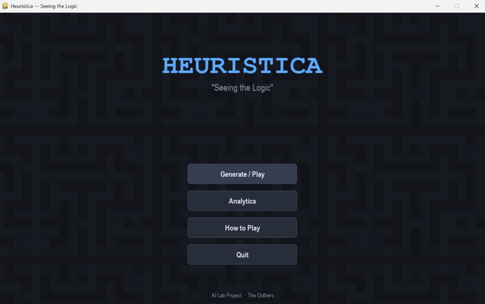
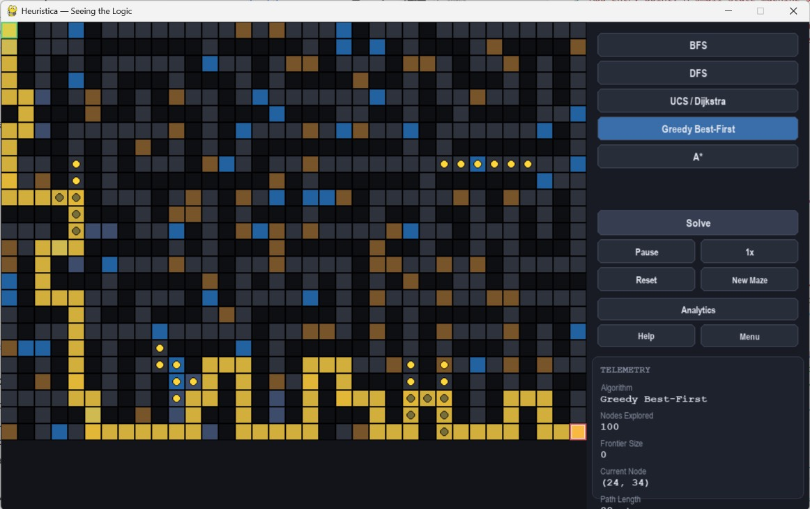
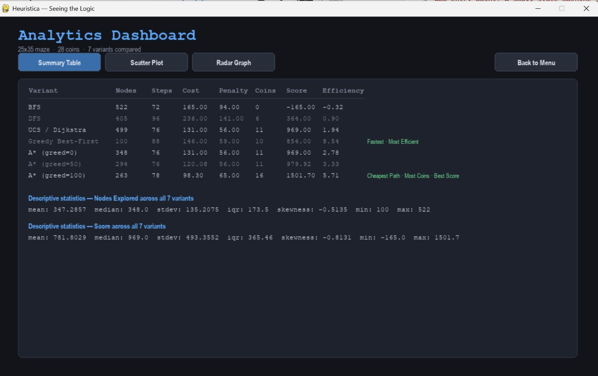
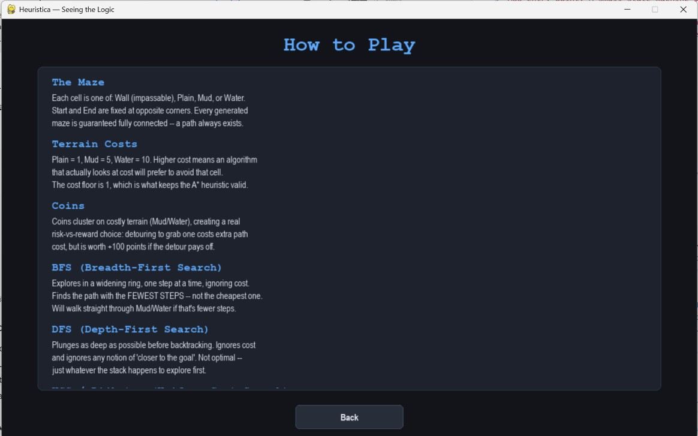

# Heuristica – Seeing the Logic

An Interactive AI-Based Maze Pathfinding Visualization Application.

## About the Project

Heuristica is an academic project developed for the Artificial Intelligence Lab course. It visualizes and compares different pathfinding algorithms through interactive maze-solving animations.

## Algorithms Implemented

- Breadth-First Search (BFS)
- Depth-First Search (DFS)
- Uniform Cost Search (UCS)
- Greedy Best-First Search
- A* Search

## Technologies Used

- Python
- Pygame
- Artificial Intelligence
- Search Algorithms
- Data Visualization

## Installation & Setup

### 1. Clone the Repository

git clone https://github.com/SkCaCo3/Heuristica.git

### 2. Navigate to the Project Folder

cd Heuristica/Heuristica

### 3. Install Dependencies

pip install -r requirements.txt

### 4. Run the Application

python main.py

## Key Features

- Interactive maze generation
- Animated pathfinding visualization
- Multiple AI search algorithms
- Real-time algorithm comparison
- Search performance analytics
- Step-by-step maze-solving visualization

## Project Documentation

See the detailed documentation and source code inside the [Heuristica folder](Heuristica/).

## Developer

Sohel Khan

GitHub: [SkCaCo3](https://github.com/SkCaCo3)

## Screenshots

### Main Menu

### Gameplay

### Analytics Dashboard

### How to Play

## Future Improvements

- Additional pathfinding algorithms
- Improved visualization interface
- Enhanced performance analysis
